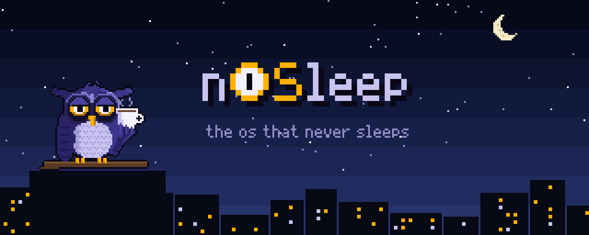
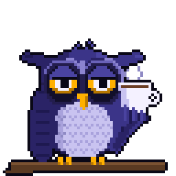
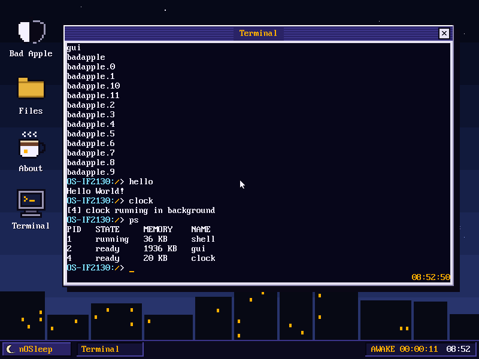
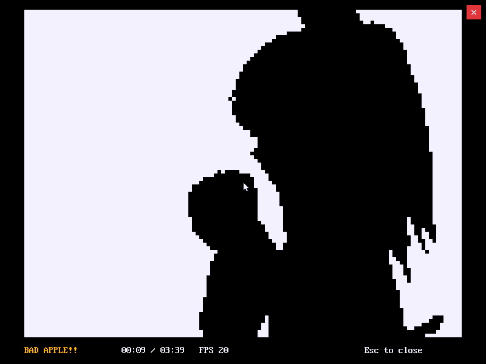

<p align="center">
  
</p>

<p align="center">
  a 32-bit x86 OS we built from scratch for IF2130 Operating Systems.<br>
  it boots and multitasks and even plays Bad Apple!!. sleep was never part of the plan.
</p>

## meet Owlnighter



Owlnighter is our mascot. He has been pulling all-nighters since Milestone 2 so the panda eyes are earned. The coffee never leaves his wing and his pupils are literally terminal cursors waiting for your next command.

Also there is no light mode. Owlnighter is sensitive to light and we respect that.

<br clear="right">

## what it can do

<p align="center">
  
  
</p>

- **boots straight into a retro desktop.** 800x600 in full color with real mouse support. Windows drag around and the shell lives inside a Terminal window just like cmd.
- **actual multitasking.** a round-robin scheduler runs on a 1000 Hz timer. Start `clock` and it keeps ticking in the background while you type. `ps` and `kill` do what you expect.
- **its own EXT2 file system.** all the usual commands like `ls` `cd` `mkdir` `cat` `cp` `rm` `mv` `find` `grep` with pipes and `>` redirects.
- **paging that respects boundaries.** every process gets its own page directory. Pages load on demand and swap to disk when RAM gets tight.
- **Bad Apple!! at 20 FPS.** 4381 frames squeezed into 712 KB and read from 12 files on disk. Hit Esc or the red X to dip.

## run it

You need Ubuntu or WSL with `gcc` `nasm` `make` `genisoimage` `qemu-system-i386` and `qemu-img`. macOS works too through Homebrew LLVM.

```bash
make disk
make insert-shell
make insert-programs
make run-nogdb
```

Click the Terminal window and type `help`. `badapple` is right there no cap.

## credits

- base kit from [OS Template 2026](https://github.com/Nathan-Marpaung/os-template-2026) by the Lab Sister ITB assistants
- [Bad Apple!!](https://youtu.be/FtutLA63Cp8) by Alstroemeria Records and Anira for the course bonus
- Owlnighter and the banner and the logo were drawn pixel by pixel for nOSleep
